# Mamba in JAX

State space models in JAX/Flax, built up in five versions:

1. a single linear SSM and its two faces (a recurrence and a convolution);
2. structured (diagonal) SSMs in the style of S4D;
3. selective SSMs (S6);
4. the full Mamba block;
5. Mamba with its HiPPO-derived initialisation.

Every version is trained on small synthetic tasks (copying and selective copying). Every version also demonstrates the defining property of these models:
- **training is parallel**: a convolution, or a parallel scan, over the whole sequence;
- **inference is recurrent**: one token at a time, from a fixed-size state;
- the two modes give the same outputs, and each script checks this.

---

## Theory

Please note that the theory corresponding to the codes is hosted on this [page](https://parag1604.github.io/notes/Machine-Learning/Sequence-Models#state-space-models) (sections "State space models", "Selectivity: Mamba" and "Mamba-2" of the Sequence Models lecture).

## Python Environment Setup

Use python >= 3.10 and install the requirements:

```bash
pip install -r requirements.txt
```

- JAX: arrays, automatic differentiation, `jit`, `vmap`, `lax.scan` and `lax.associative_scan` (install the CUDA build for an NVIDIA GPU)
- Flax (linen): neural network layers
- Optax: the optimiser
- NumPy, Matplotlib: generating the tasks and plotting

On Apple silicon the experimental `jax-metal` plugin does not support all the operations used here, so run on the CPU with `JAX_PLATFORMS=cpu python ...`.

## Data

No dataset is needed. The tasks are generated on the fly (`utils.py`).

Token 0 is a blank, tokens 1–8 are data, and token 9 is a marker. The model is scored on the marker positions only, so chance is 1/8.

- **Copying**: 8 data tokens at the start of the sequence, then 64 blanks, then 8 markers. At the markers the model must output the data tokens in order. The data always sit at the same distance from the markers, so a fixed time shift (a convolution) solves it.
- **Selective copying** (Gu and Dao, 2023): the same, but the 8 data tokens sit at random positions among the 64 blanks. The model must decide, from the content of each token, whether to remember it.
- **Induction heads** (optional, `--task induction`): random tokens, a trigger token followed by a value somewhere, and the trigger again at the end. The model must recall the value.

The default sequence length is 64 + 8 = 72.

## Running

```bash
JAX_PLATFORMS=cpu python version1.py
JAX_PLATFORMS=cpu python version2.py --task copy          # or --task selective
JAX_PLATFORMS=cpu python version3.py --task selective
JAX_PLATFORMS=cpu python version4.py --task selective
JAX_PLATFORMS=cpu python version5.py --task selective     # S4D-Real + log-uniform Δ
bash run_all.sh        # every run behind the numbers below, then plot_results.py
```

Versions 2–5 accept these flags:
- task and data: `--task {copy,selective,induction}`, `--n_mem`, `--n_tokens`;
- model: `--d_model`, `--n_layers`, `--d_state`;
- training: `--steps`, `--batch_size`, `--lr`, `--seed`;
- output: `--save_history FILE` (writes the learning curve as JSON);
- mode: `--skip_demo` (train only) or `--skip_train` (run the demos only).

Default model: 2 layers, `d_model` 64, state size N = 16, Adam with a 3e-3 cosine schedule, batch 64, 2000 steps.

Quick check (about a minute on a CPU): `python version4.py --steps 100 --skip_demo`.

**What was run.** Everything below ran on an Apple M2 CPU (8 cores, JAX 0.5.0, Flax 0.10.4).

The learning-curve runs (`runs/`) shared the CPU with 3–4 other runs, so these times are pessimistic:
- about 3 minutes per version 2 run (2000 steps);
- about 21 minutes per version 3 run;
- about 44 minutes per version 4 run;
- about 20 minutes per 1000-step version 5 run.

On an idle CPU the per-step costs are about 25 ms (version 2), 0.2 s (version 3) and 0.48 s (version 4).

The timing and equality demos, and the figures from trained models (kernels, Δ_t), were regenerated on the idle CPU:
- `version2.py --task copy`: 2000 steps, 99.2%;
- `version3.py --task selective --steps 1000`: 84.9%;
- `version4.py --task selective --steps 1000`: 97.9%.

`plot_results.py` turns the saved learning curves (`runs/`, not committed) into the figures.

---

### Version 1: the state space model and its two views

```bash
python version1.py
```

A continuous linear SSM, `x'(t) = A x(t) + B u(t)`, `y(t) = C x(t) + D u(t)`, with the following pieces.

**Discretisation.** Two schemes turn it into `x_k = Ā x_{k-1} + B̄ u_k`, `y_k = C x_k + D u_k`:
- **zero-order hold**: `Ā = exp(ΔA)`, `B̄ = A⁻¹(exp(ΔA) − I)B`. It is computed without inverting A, from the exponential of the block matrix `[[A, B], [0, 0]]·Δ`.
- **bilinear** (Tustin, used by S4; Parag's original code): `Ā = (I − Δ/2·A)⁻¹(I + Δ/2·A)`, `B̄ = (I − Δ/2·A)⁻¹ΔB`.

**The same output, computed two ways:**
- the **recurrent view**, a `lax.scan` over time with an O(N) state;
- the **convolutional view**, `y = K * u + D u` with the kernel `K = (CB̄, CĀB̄, CĀ²B̄, …)`, computed with the FFT for all positions at once.

**Results:**
- The recurrence and the convolution (FFT or direct) agree to 5e-7.
- A random uniform A gives an unstable discrete system (largest |eigenvalue| of Ā is 1.03). The HiPPO matrix of version 5 does not (0.996).
- Discretisation error against the exact continuous solution, for a smooth input (computed in float64): both schemes are O(Δ²). Zero-order hold is about 6× more accurate here: 9.6e-6 against 5.6e-5 at Δ = 0.0125.

**A trainable SSM layer** (dense A, with learned B, C, D and log Δ) is trained in convolution mode to delay its input by 10 steps. Then it is run as an RNN.

After 4000 Adam steps (3 s), the test MSE is 0.007, against about 1 for predicting zero. The learned Δ is 0.47. The kernel has a broad bump around lag 10: a 16-state SSM can only approximate a pure delay. Convolution mode and recurrent mode agree to 1.2e-6.

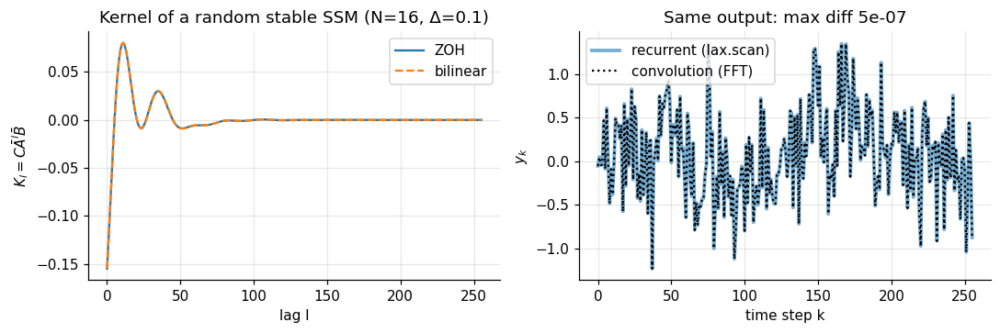
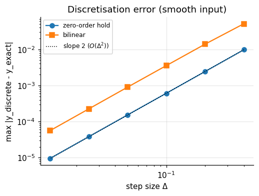
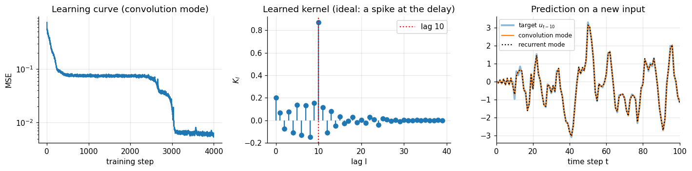

### Version 2: structured state space models (S4D)

```bash
python version2.py --task copy
python version2.py --task selective
```

**Structure: a diagonal A.** In version 1, building the kernel costs O(L N²) per channel, with an N×N matrix exponential. With a diagonal, complex A, every mode evolves on its own:

```
Ā_n = exp(Δ a_n),   B̄_n = (Ā_n − 1)/a_n · B_n,   K_l = 2 Re Σ_n C_n B̄_n Ā_nˡ
```

This is a Vandermonde product, O(N L), and trivially parallel. The modes come in conjugate pairs, so only N/2 of them are stored (S4D: Gu, Gupta et al., 2022).

**Training** builds K once per step and convolves with the FFT, in O(L log L).

**Inference** (`decode=True`, a `cache` collection) runs the same parameters as an RNN, with N/2 complex numbers of state per channel.

**The network around the layer** is Parag's original S4 code, adapted from *The Annotated S4* by Rush and Karamcheti, MIT licence:
- `cloneLayer`: one SSM per channel, via `nn.vmap`;
- `SequenceBlock`: SSM, GELU, gated linear unit, LayerNorm, residual;
- `StackedModel` and `BatchStackedModel`.

The only addition is the cache that holds the recurrent state.

**The S4 / DPLR idea.**
- The original S4 uses the HiPPO matrix of version 5 for A. That matrix cannot be diagonalised in a numerically stable way: its eigenvectors are exponentially ill-conditioned.
- It is, however, *normal plus low rank*: `A = S − P Pᵀ` with S normal. So S4 writes `A = V(Λ − P̃ Q̃*)V*`, *diagonal plus low rank* (DPLR), in a well-conditioned basis.
- It never forms Āˡ. It computes the kernel's generating function at the roots of unity instead:
  - the diagonal part gives a Cauchy kernel `Σ_n c_n / (ω − λ_n)`;
  - the rank-one correction is folded in with the Woodbury identity;
  - an inverse FFT recovers K, in time nearly linear in N + L.
- S4D then showed that simply dropping the low-rank term, keeping only the diagonal part with a good initialisation, works about as well and is far simpler. That is what this version implements.

**Results:**
- **Kernel cost** for L = 1024 and 64 channels: dense A takes 775 ms at N = 256, against 31 ms for the diagonal.
- **Training mode equals inference mode**: max |difference| of the logits is 8e-5, for logits up to 64 (a relative error of about 1e-6).

**Generating one token**:
- a recurrent step costs about 0.03 ms, whatever the context length;
- re-running the FFT convolution over the whole prefix costs 0.4 ms at t = 64 and 107 ms at t = 16384.

For whole sequences, training mode (FFT) is about 2× faster than a recurrent scan even on this CPU: 140 ms against 231 ms at L = 4096, batch 16.
- **Accuracy:**
  - copying: 99.2% test accuracy;
  - selective copying: **70.3%** (2 layers, length 72). With S4D-Lin initialisation: 98.3% and 68.6%.
- **Why selective copying fails.** The model is linear and *time invariant*: the same kernel is applied to every input. A fixed shift solves copying, but selective copying needs memory that depends on content. With two layers and nonlinear channel mixing in between, it still gets part of the way at this short length.

**At a longer memory the failure is clearer.** On selective copying with 256 blanks (L = 264, 1 layer, `d_model` 32, batch 32), S4D stays at **26%** after 2000 steps, against 48–51% for Mamba with the same width (see version 5).

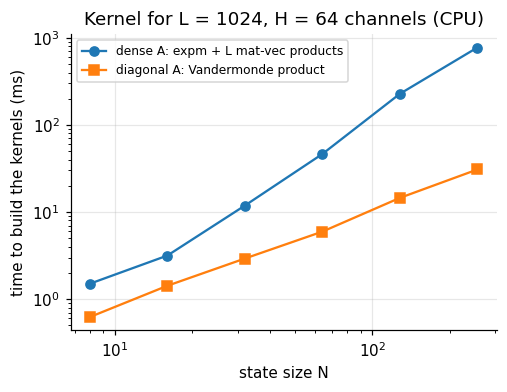
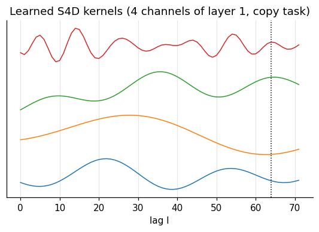
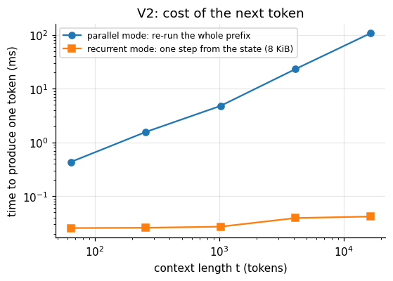

### Version 3: selective state space models (S6)

```bash
python version3.py --task selective
```

**Selection** (Gu and Dao, 2023). Δ, B and C become functions of the current input:

```
Δ_t = softplus(W_Δ W_r u_t + b_Δ),   B_t = W_B u_t,   C_t = W_C u_t
h_t = exp(Δ_t A) h_{t-1} + Δ_t B_t u_t,   y_t = C_t h_t + D u_t
```

- A stays a fixed, diagonal, negative parameter.
- As in Mamba, A uses ZOH and B uses the simpler Euler rule.
- A large Δ_t lets a token overwrite the state ("remember this"). A small Δ_t leaves the state unchanged ("ignore this").

The figure `v3_selection_delta.png` shows Δ_t (averaged over channels) on one input. In the trained model Δ_t clearly depends on the content: data tokens get different step sizes from blanks. The channel average does not follow the simple cartoon of "large on data, small on blanks", though. Different channels use Δ differently, and in this run the average is *lower* on data tokens.

**There is no convolution kernel any more**, because the system is time varying. Training uses the **parallel associative scan** instead:
- One step is the affine map `h ↦ a_t h + b_t`.
- Composing two steps gives `(a₁, b₁) ∘ (a₂, b₂) = (a₁a₂, a₂b₁ + b₂)`, which is associative.
- So all h_t can be computed in O(log L) parallel rounds.

The file implements three scans:
- sequential (`lax.scan`);
- Hillis–Steele (Parag's original, following F. Heinsen's `torch_parallel_scan`);
- Blelloch (`lax.associative_scan`).

Inference is still recurrent.

To isolate the effect of selection, everything else is unchanged: S6 simply replaces the S4D bank inside the version 2 network.

> **A note on names.** S4 stands for the *structured* state space sequence model: a structured A, time invariant, trained as a convolution. Its selective, input-dependent version, the SSM inside Mamba, is called **S6** in the Mamba paper (S4 + selection + scan). So the "selective structured SSM" of this version is S6, not S4.

**Results:**
- **The three scans agree** to 1e-6 (L up to 16384, 256 channels).
- **Scan speed on this CPU**: the sequential scan is fastest (4.3 ms against 12.2 ms for Blelloch at L = 16384), because there is little parallel hardware to use. The unrolled Hillis–Steele scan does O(L log L) work and is far slower (507 ms). The parallel scans pay off on GPUs.
- **Training mode equals inference mode** to 4.6e-5, for logits up to 73.
- **Generating one token**: a recurrent step costs about 0.06 ms, against 276 ms to re-run the parallel scan on a prefix of 16384.
- **Accuracy:**
  - selective copying: **93.7%**, against 70.3% for the LTI model of version 2 with the same network;
  - copying: 89.1%. With the naive initialisation (see version 5), plain copying over 64 steps is actually harder for this model than for S4D.

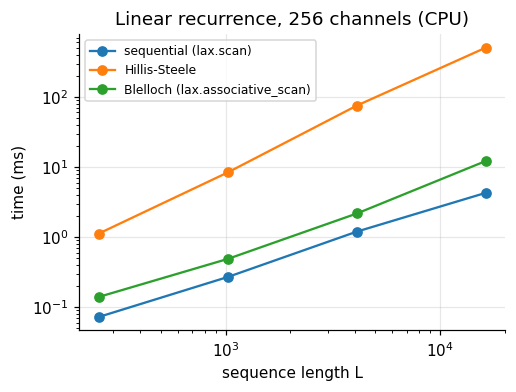
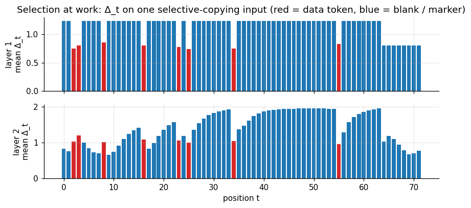
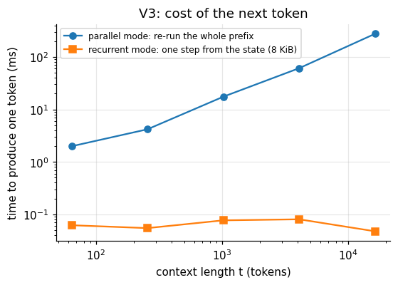

### Version 4: Mamba

```bash
python version4.py --task selective
```

The selective SSM is unchanged. What is new is the block around it (Gu and Dao, 2023, Fig. 3):

```
x ── in_proj ──> [u | z]
u ─> causal depthwise conv1d (k = 4) ─> SiLU ─> selective SSM ─> y
y · SiLU(z) ─> out_proj
```

The blocks are stacked with pre-RMSNorm residual connections, `x ← x + MambaBlock(RMSNorm(x))`.

The recurrent state of a block has two parts, both of fixed size:
- the SSM state h, of size E × N;
- the last k − 1 inputs of the convolution.

Decoding token by token reproduces the parallel outputs.

**Results:**
- **Training mode equals inference mode** to 1.1e-5, for logits up to 10.
- **Recurrent state**: 19 KiB in total, whatever the context length.
- **Generating one token**:
  - a recurrent step costs 0.06–0.09 ms, flat in the context length;
  - re-running the parallel forward on the whole prefix costs 2.3 ms at t = 64 and 393 ms at t = 16384.
- **Whole sequences**: on this CPU the associative scan is no faster than a recurrent `lax.scan` (1.5 s against 1.0 s at L = 4096, batch 16). The parallel form is what makes training fast on a GPU.
- **The Δ_t figure**: as in version 3, Δ_t depends on the content, but its average over channels does not single out the data tokens.
- **Accuracy:**
  - selective copying: 95% by step 750 and 99.0% by step 1000.
  It reaches 100% after 2000 steps.
  - copying: 100% from step 500 on.

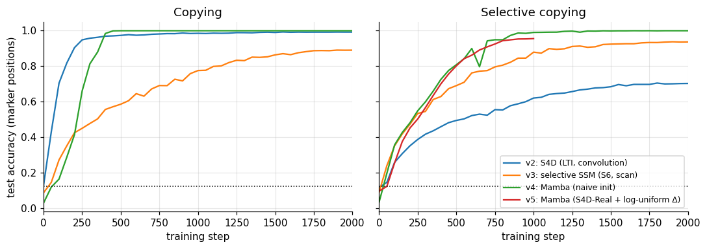
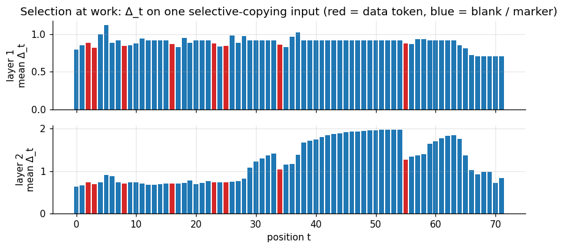
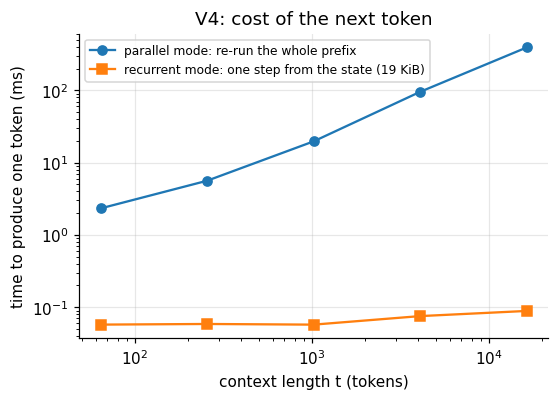

### Version 5: Mamba with HiPPO initialisation

```bash
python version5.py --A_init real --dt_init loguniform   # S4D-Real (default)
python version5.py --A_init lin  --dt_init loguniform   # S4D-Lin (complex modes)
python version5.py --A_init random --dt_init default    # = version 4
```

Only the initial values of A and Δ change.

**HiPPO** (Gu et al., 2020) chooses A so that the state is an optimal online summary of the input's history. For the scaled Legendre measure (LegS) this gives the lower-triangular matrix of version 1 (`make_HiPPO`). The script checks that `S = A + P Pᵀ`, with `P_n = √(n + ½)`, is −I/2 plus a skew-symmetric matrix. So its eigenvalues are `−½ + iω_n`.

The diagonal initialisations, from S4D:

| init | a_n | origin |
|---|---|---|
| S4D-LegS | the exact eigenvalues of S | HiPPO-LegS, its normal part |
| S4D-Inv | −½ + i N/π (N/(2n+1) − 1) | a closed-form fit of S4D-LegS |
| **S4D-Real** | −(n + 1) | the diagonal of the LegS matrix; Mamba's default |
| S4D-Lin | −½ + iπn | from the **Fourier** variant of HiPPO (FouT), not LegS: a damped Fourier basis |

**Δ.** The bias of the Δ projection is set so that `softplus(bias)` is log-uniform in [1e-3, 1e-1].

**The effect: memory lengths.** The memory length of a mode is 1/(Δ|Re a_n|).
- With S4D-Real and log-uniform Δ the memory lengths spread over orders of magnitude: median 13.6 steps, and 17% of the modes remember longer than 64 steps.
- The naive initialisation of versions 3–4 (−A ~ U(0.1, 1), Δ ≈ softplus(0) = 0.69) gives a median of 2.7 steps, and no mode longer than 64 steps.

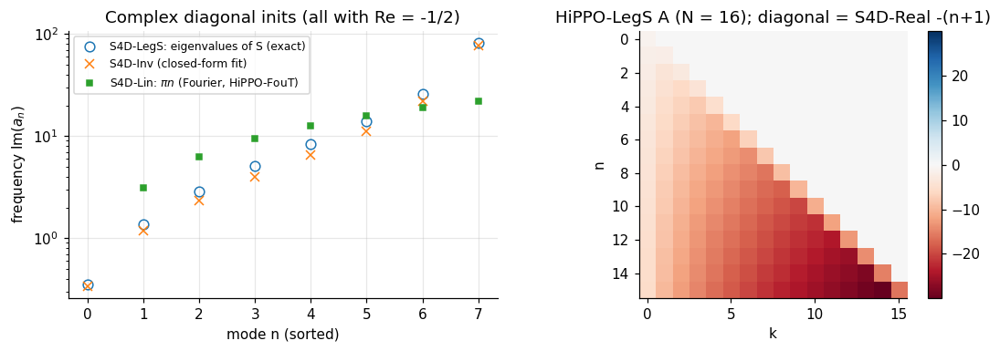
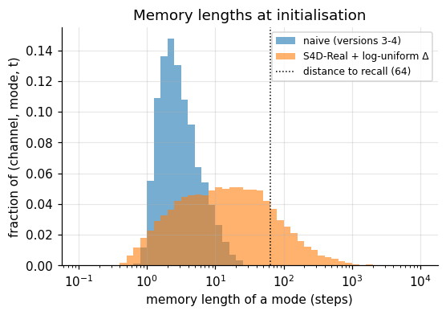

**Does the initialisation help? Not at the default length.**

Mamba on selective copying, L = 72, 1000 steps (a shorter cosine schedule than version 4's 2000), seed 0:

| init | test accuracy | steps to 90% |
|---|---|---|
| naive (version 4): −A ~ U(0.1, 1), Δ ≈ 0.69 | 97.9% | 650 |
| S4D-Real + log-uniform Δ | 95.6% | 700 |

At this length the naive model learns the task just as fast. Its selection mechanism quickly learns small Δ values on blanks, so the short initial memory is not a bottleneck. This is a single seed, and the 2-point difference is within run-to-run noise.

At L = 264 (1 layer, `d_model` 32, batch 32, 1500 steps), neither Mamba initialisation solves the task in the budget I could afford on a CPU:
- S4D-Real with log-uniform Δ: **51.2%**;
- naive: **48.1%**;
- S4D, for comparison: 26.3%.

HiPPO is slightly ahead there, but the gap is small and comes from one seed. These experiments do **not** show the large gains reported for long sequences (Gu et al., S4D; Gu and Dao, Mamba). Showing them would need longer sequences and more training, which is better done on a GPU (`run_all.sh` has the commands).

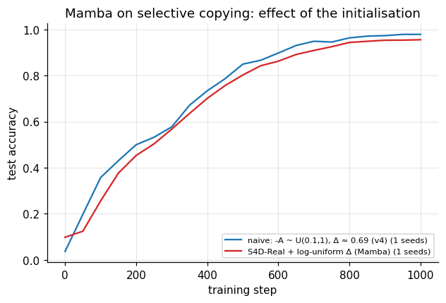
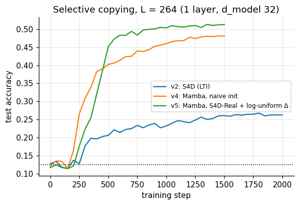

---

## Summary

Test accuracy on the marker positions (512 fresh sequences; chance 12.5%). Apple M2 CPU.

| model | copying (L = 72) | selective copying (L = 72) | selective copying (L = 264, 1 layer, d=32) |
|---|---|---|---|
| v2: S4D (LTI, FFT convolution) | 99.2% | 70.3% | 26.3% |
| v3: selective SSM (S6) in the v2 network | 89.1% | 93.7% | – |
| v4: Mamba, naive init | 100% | 100% (99.0% at step 1000) | 48.1% |
| v5: Mamba, S4D-Real + log-uniform Δ | – | 95.6% (1000 steps) | 51.2% |

The L = 72 runs use 2 layers and `d_model` 64, with 2000 steps unless stated. The L = 264 runs use 1500 steps for Mamba and 2000 for S4D.

| check | max \|training mode − recurrent mode\| |
|---|---|
| v1 SSM (recurrence vs FFT convolution) | 5e-7 |
| v2 S4D network (logits up to 64) | 8e-5 |
| v3 S6 network (logits up to 73) | 5e-5 |
| v4 Mamba (logits up to 10) | 1e-5 |


## References

- A. Gu, T. Dao, S. Ermon, A. Rudra, C. Ré (2020). *HiPPO: Recurrent Memory with Optimal Polynomial Projections*. NeurIPS. https://arxiv.org/abs/2008.07669
- A. Gu, K. Goel, C. Ré (2022). *Efficiently Modeling Long Sequences with Structured State Spaces* (S4). ICLR. https://arxiv.org/abs/2111.00396
- A. Gu, A. Gupta, K. Goel, C. Ré (2022). *On the Parameterization and Initialization of Diagonal State Space Models* (S4D). NeurIPS. https://arxiv.org/abs/2206.11893
- A. Gu, T. Dao (2023). *Mamba: Linear-Time Sequence Modeling with Selective State Spaces*. https://arxiv.org/abs/2312.00752
- S. Rush, S. Karamcheti. *The Annotated S4*. https://srush.github.io/annotated-s4/
- G. Blelloch (1990). *Prefix Sums and Their Applications*. CMU-CS-90-190.
